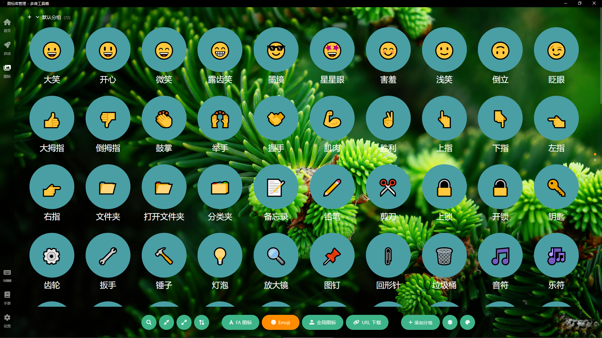
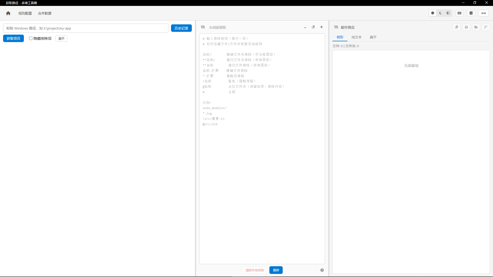

# 多维工具箱

> 把日常重复操作压缩到最少步骤。

基于 Vue 3 + Electron 的桌面工具集合，支持启动本地应用、网页、文件夹。

本软件由 AI 辅助开发，功能基于制作者个人需求定制。开源协议下欢迎自由修改以适应你的需求。

## 功能模块

- **首页** — 导航中枢，工作空间管理、开机自启、默认启动页设置
- **启动页** — 一键启动工作环境，树形菜单 + 卡片管理，支持拖拽排序
- **图标库** — 集中管理 FA/Emoji/自定义图标，分组管理、颜色配置
- **获取路径页** — 规则驱动文件筛选 + 合并输出

## 页面简介

**首页**  导航中枢与全局设置。中央三个入口直达启动页、图标库和获取路径页；底部工具栏集成设置、工作空间切换、开机自启开关、默认启动页选择、手册与主题切换，所有全局配置一步可达。

**启动页**  一键启动工作环境。左侧树形菜单管理应用分组，右侧卡片网格展示快捷入口，支持网页、文件夹、本地程序三种类型。毛玻璃背景与壁纸融合，Tab 键切换紧凑模式隐藏编辑功能只保留快速选择，拖拽排序自由组织卡片和菜单。

**图标库 — FA 图标**  集中管理 FontAwesome 图标，按分组组织，卡片和菜单通过图标值引用而非复制。支持 67 个 FA 分类浏览，颜色可分层预览与持久化，拖拽调色板时仅更新 CSS 变量避免卡顿。

**图标库 — Emoji**  Unicode Emoji 图标管理，按 8 个分类浏览，系统渲染无需物理文件存储。与 FA 图标共享表单弹窗，通过类别自动切换输入校验规则。

**获取路径页**  规则驱动的文件筛选器。七类规则（排除/递归排除/通配/豁免/占位等）统一顺序列表、后写优先，用 `.mdignore` 格式持久化。三栏布局，中栏、右栏可独立显隐，渐进式扫描大项目不卡顿，预览支持树形/纯文本/扁平三种视图，合并输出多项目代码。

## 特性

- **工作空间隔离** — 多工作空间各自独立数据目录，路径即数据根，切换即重启，互不残留状态
- **规则驱动** — 获取路径页用排除/豁免/占位/通配规则代替手动挑选，后写优先保证灵活控制
- **视觉即功能** — 颜色/图标区分状态，树形结构组织层级，毛玻璃提供统一视觉背景
- **编辑态/浏览态分离** — 启动页紧凑模式隐藏编辑功能只保留选择，获取路径页中、右栏可独立显隐

## 快捷键

| 按键 | 功能 |
|------|------|
| F1 | 打开当前页面手册（新窗口） |
| F2 | 重命名（启动页菜单 / 图标库分组） |
| Home | 返回首页 |
| 1 / 2 / 3 | 切换到启动页 / 图标库 / 获取路径页 |
| Ctrl+1 / 2 / 3 | 新窗口打开启动页 / 图标库 / 获取路径页 |
| Ctrl+F | 搜索（启动页 / 图标库） |
| Tab / ESC | 切换 / 退出紧凑模式（启动页 / 图标库） |
| Q / W / E | 切换中栏 / 右栏可见性 / 重置布局（获取路径页） |

## 技术栈

- Vue 3 + TypeScript + Vite
- Electron + Electron Builder
- Pinia + Vue Router
- FontAwesome + SortableJS

## 平台

Windows x64

## 开发

详见 [开发指南](docs/开发指南.md)

## 开发辅助模型

- **特别鸣谢**：华为云码道CodeArts代码智能体
- deepseek-v4-flash
- deepseek-v4-pro
- GLM-5.2

## 开源许可

[MIT](LICENSE)
