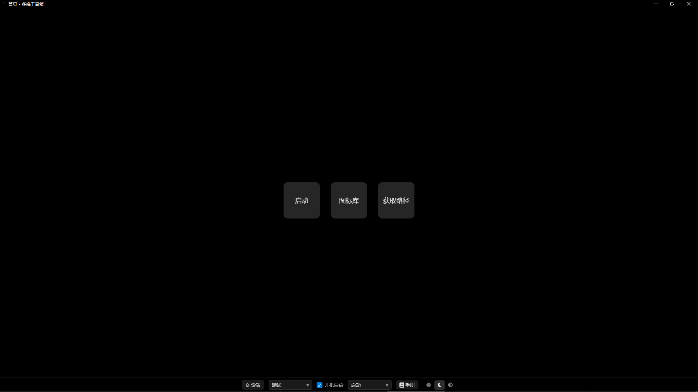

# 项目总览

> **多维工具箱：把日常重复操作压缩到最少步骤。**

一个 Windows 桌面应用。收录常用资源一键启动，可视化筛选项目文件并合并输出，统一管理图标。

## 核心构思：多套数据，一个应用

「工作空间」是各模块数据的**物理隔离单元**——每个工作空间对应磁盘上一个目录，路径即数据根，切换即重启整套数据。

同一套软件、多份可独立使用与备份的数据环境，是本项目最核心的构思。

## 模块

| 模块 | 路由 | 干什么 |
|------|------|--------|
| [首页](./首页文档.md) | `/` | 导航中枢 + 工作空间管理（新建/复制/删除，可迁移到其它盘） |
| [启动页](./启动页文档.md) | `/Q1` | 一键启动工作环境：网页、文件夹、程序、图片、音乐、视频 |
| [图标库页](./图标库页文档.md) | `/图标库管理` | 集中管理全部图标，供卡片与菜单按「图标值」引用（数字键 `2` 直达） |
| 记忆泡 | `/记忆泡` | 单人气泡式记忆记录（外观第一版，数字键 `3` 直达） |
| [获取路径页](./获取路径页文档.md) | `/H1` | 规则驱动筛选文件 + 合并输出为单一文本（数字键 `4` 直达） |
| 手册页 | `/manual/:id` | F1 打开当前页面手册 |

## 模块依赖与边界

| 模块 | 依赖关系 | 约束 |
|------|---------|------|
| 启动页 ⟷ 图标库页 | **互相依赖**：启动页的卡片/菜单通过图标库仓库取图标；图标库管理视图本身位于启动页目录 | **不可单独删除**，边界要一起维护 |
| 获取路径页 | **完全独立**（其他模块零引用） | 可单独删除，不影响其它模块 |

开发时需确保这三者的边界保持正常。

## 设计理念展开

1. **最少步骤** — 每个模块都在减少重复操作。启动页一键开所有东西；获取路径页一键生成干净文件树。
   *体现*：启动页的卡片/菜单、图标库的按域名自动匹配、获取路径页的一键收集合并。
2. **规则驱动** — 用排除/豁免/占位/通配规则代替手动挑选。
   *体现*：获取路径页两级规则（全局物理过滤 + 项目决定展示状态），**后写优先**保证灵活控制；语法仿 `.gitignore`，降低学习成本。
3. **视觉即功能** — 颜色与图标用来**区分状态**，不是装饰；树形结构组织层级；毛玻璃提供统一视觉背景。
   *体现*：获取路径页节点四态、图标库分层预览、启动页毛玻璃层。
4. **编辑态 / 浏览态分离** — 编辑与使用互不干扰。
   *体现*：启动页紧凑模式隐藏一切编辑功能、只保留二级菜单图标列；获取路径页中栏与右栏可独立显隐。
5. **工作空间隔离** — 每个空间独立数据目录，路径即数据根。
   *体现*：切换即 `app.relaunch()` 重启，不做热切换，避免状态残留。

## 文档导航

| 文档 | 内容 |
|------|------|
| [首页文档](./首页文档.md) | 工作空间管理、迁移到其它盘 |
| [启动页文档](./启动页文档.md) | 两种工作状态、菜单与卡片、壁纸 |
| [图标库页文档](./图标库页文档.md) | 集中管理与引用、四类图标、分组与操作 |
| [获取路径页文档](./获取路径页文档.md) | 两级规则、七类规则语义、扫描与合并设计 |
| [开发指南](./开发指南.md) | 技术栈、环境要求、命令、快捷键 |
